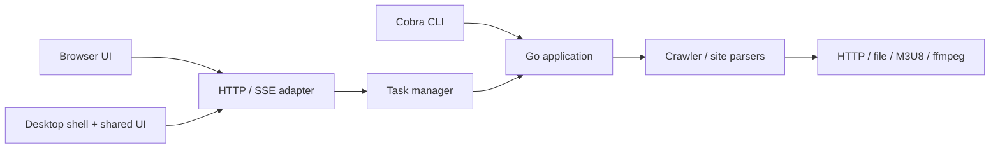

# 三端复用架构

## 包边界

- `core/application`：单 URL 与批次下载用例。批次请求 `Batch{Site, Names}` 经批次源注册表解析为列表页 URL，校验输入、汇总结果。桌面端无需重写这些规则。
- `core/tasks`：任务 ID、单 worker 队列、状态、取消、重试（完整 / 仅失败部分）、删除单条与清空、文件计数统计（`Stats`）与终态记录持久化；不依赖 HTTP、Cobra 或前端。
- `core/events`：日志、阶段、计划（plan，宣布本轮文件总数）、字节 / 片段进度和文件成功 / 失败事件。
- `core/crawler`：一次抓取的编排与文件结果；每次执行创建独立 crawler、client 和 parser。`SkipFiles` 命中的文件直接记成功，服务局部重试。
- `core/parsers`：站点解析器与批次源注册表（`BatchSource` 把查询解析为列表页 URL，候选回退属于站点语义）；`ListOptions` 经 `ListOptionsAware` 按任务注入。部分解析失败写入 `ParseResult.Failures`。
- `core/request`：传输、下载与合并；任务 client 携带 context 和 observer，子请求复用它们。
- `cmd`：参数解析、终端输出、退出码、服务启动、任务历史文件路径与系统浏览器启动。
- `server`：JSON DTO、会话鉴权、Host / Origin 校验、SSE、批次源能力发现（`/api/session` 返回 `batch_sites`）和嵌入式静态资源。

## 执行约定

`application.Execute(ctx, request, observer)` 是当前共用入口。调用者负责传入完整默认配置（`config.New()`），或在服务端将 JSON 配置合并到默认值。每个任务独立拥有配置；不修改全局解析器参数。

observer 在一个 crawler 内串行调用，应迅速返回。解析完成后 crawler 发出 plan 事件（本轮文件总数），任务服务据此聚合 `Stats{Total, Completed, Failed}`；进度事件按文件组织，普通文件以 bytes、M3U8 以 segments 计量，每个文件在任务的 progress 映射中保留最后一个事件，前端据此区分下载中 / 失败 / 完成。未知总长度使用 total=0，前端不显示百分比。core 不创建终端进度条，也不向 stdout 打印日志。

请求使用任务 context；重试等待、代理 CONNECT / TLS 和 ffmpeg 也响应取消。取消正在运行的任务先进入 canceling，执行结束后进入 canceled。排队任务取消后不会执行。

任务部分失败时，返回已完成和失败的文件结果，同时返回错误。CLI 返回非零退出码，任务服务记录 failed。错误不再仅通过日志表达。

重试是新建任务而非原地续跑：`Retry(id, scope=all)` 克隆原请求重新入队；`scope=failed` 把上次成功收集的文件名写入 `SkipFiles`，crawler 解析阶段整体重跑（上次解析期失败的条目因此被重新覆盖），下载阶段跳过已成功文件。文件名按解析产物匹配，重跑时标题变化会导致跳过失效。

队列串行执行任务，任务内并发下载，避免同一输出目录被多个 GUI 任务同时写入。独立运行的 CLI 进程之间尚无文件锁；不应同时下载相同内容到同一目录。

## 本地 Web 与桌面适配

共享 React 前端位于 `apps/frontend`，构建产物复制到 `server/ui` 并使用 `go:embed` 打包。默认 loopback 同源提供 UI、API 和 SSE；无需 Node 生产运行时。框架无关的 API 客户端位于 `packages/api-client`，系统能力位于 `packages/platform`。

Tauri 桌面壳启动 `medianinja-core serve --desktop` 子进程，从首行 JSON 读取随机端口服务地址，加载同一 React 页面。外层负责窗口、托盘、文件选择、通知和进程生命周期；页面调用同源会话 API，不需要读取 bearer token。壳持有 stdin 管道，退出或崩溃会触发服务取消任务并关闭。由于会校验 Host，必须使用服务实际打印的地址，不能将 127.0.0.1 随意换成 localhost。

ffmpeg 从 PATH 或可执行文件所在目录查找。分发时 Go exe 与 ffmpeg 仍须按目标 OS / 架构构建或准备。

## 当前范围与下一步

任务历史保留在内存并持久化终态记录：`serve` 默认把已结束任务写入每用户配置目录（`os.UserConfigDir()/MediaNinja/tasks.json`，`--state` 可覆盖），启动时加载，删除单条 / 清空 / 新终态时原子落盘；运行中任务不跨重启。队列最多 32 个等待任务，最多保留 200 个任务记录（提交新任务时淘汰最早的已结束记录）；服务不提供多用户或公网访问。支持取消、完整 / 局部重试、单条删除与清空，以及已有下载的断点恢复；没有自动恢复重启前的运行中任务、暂停任务或持久化事件日志。

可以按需求继续增加：更多批次源接入 `BatchSource` 注册表、暂停任务、分析预览与下载计划分离、影剧库与外部播放器、远程部署鉴权与存储权限。HTTP 路由与 CLI 继续依赖应用入口，业务规则保持在 Go 中。
